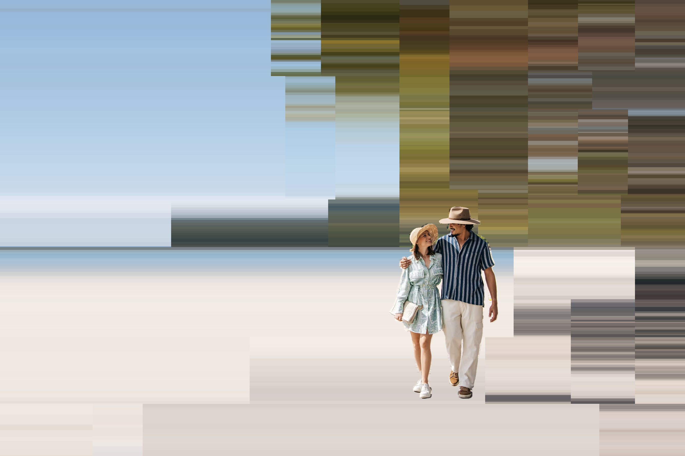
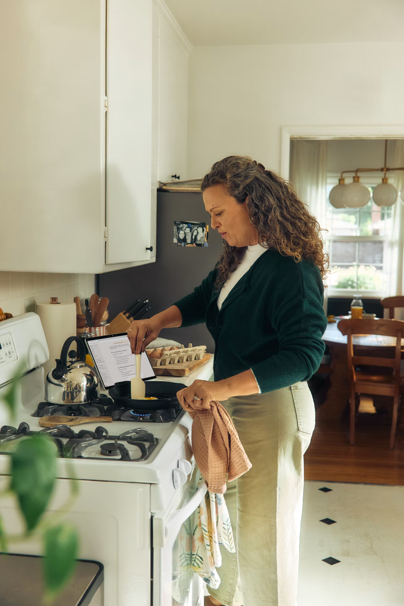
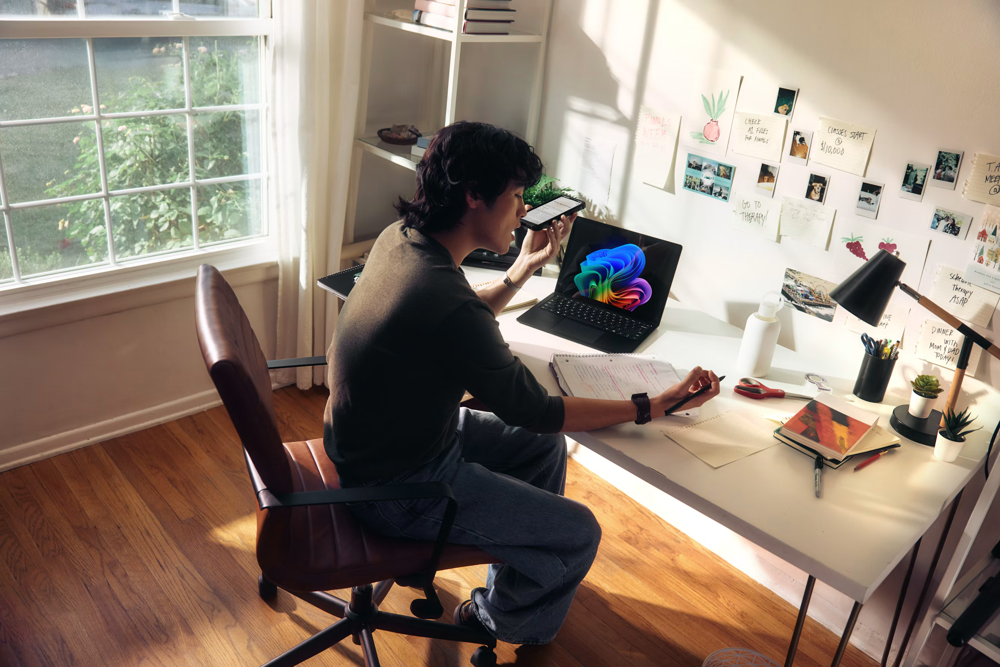

# 照片背景横纹 · Photo Horizontal Stripes

把照片背景概括成宽窄交替、错落起止的横向色带。色带从各处原图取色，保留大致的色面与明暗位置。竖直方向的近似色阶合并为纯色段，在色差明显处直接跳档。人物、产品或用户指定的小物件可以保持清晰。

## 示例

左侧为原图，右侧为横纹效果。点击任一缩略图查看全尺寸。

| 场景 | 原图 | 横纹效果 |
| --- | --- | --- |
| 海滩 | <a href="examples/beach-original.avif"></a> | <a href="examples/beach-result.png"></a> |
| 厨房 | <a href="examples/kitchen-original.png"></a> | <a href="examples/kitchen-result.png"></a> |
| 书房 | <a href="examples/study-original.png"></a> | <a href="examples/study-result.png"></a> |

## 使用

- **支持技能文件的 AI**。按平台的方式导入包含 [SKILL.md](SKILL.md)、`scripts/` 和 [PROMPT.md](PROMPT.md) 的目录。上传原片并指定主体，例如「保留做饭的人、锅铲、锅和手里的布，其他背景做成横纹」。
- **支持上传图片和编辑图片的对话 AI**。上传原片，复制 [对话生图提示词](PROMPT.md)，将 `xxx` 换成想保留的对象。也可加传上表的一张成片作为风格参照。模型直接编辑可能改变人物、文字或细节。
- **本地 Python**。准备与原图显示尺寸一致的灰度蒙版，白色保留，黑色处理，灰色用于轮廓过渡。渲染器读取蒙版，完全保护的 RGB 像素逐像素保留。

```sh
python -m pip install Pillow numpy
python scripts/render_stripes.py input.jpg mask.png output.png
```

默认模式适合宽窄交错、色阶略硬的效果。用 `--texture fine` 得到细密纹理，用 `--texture wide` 得到更概括的色带，用 `--strength 0.65` 多保留一些背景结构。输出 PNG 与原图显示尺寸一致，脚本拒绝覆盖已有文件。

## English quick start

Upload a source photo and describe what to protect. Import [SKILL.md](SKILL.md) with its companion files on a skill-capable platform, or paste the [image-editing prompt](PROMPT.md) into a chat that accepts image uploads. For exact RGB preservation inside the subject, run the local renderer with a grayscale mask. White protects, black transforms, and gray blends the edges. The result uses locally sampled horizontal bands with staggered breaks and discrete vertical color steps.

## License

The skill instructions, prompt, and renderer are available under the [MIT License](LICENSE). The example images are provided for visual reference.
